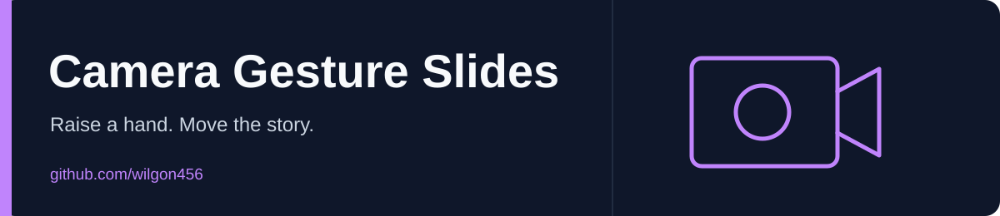

<div align="center">



# Camera Gesture Slides

Navigate an HTML presentation with hand gestures, keyboard controls or on-screen buttons.

**English** · [한국어](README.ko.md)

 

[Repository](https://github.com/wilgon456/ppt_camera_html)

</div>

---

## Features

- Use an index-finger swipe to move between slides.
- Hold an open palm to enlarge a slide image where one is available.
- Navigate with arrow keys or the on-screen previous/next buttons.
- Adjust zoom and toggle the camera preview.
- Track hands with MediaPipe; face detection helps select the presenter's hand.

## Run locally

```bash
git clone https://github.com/wilgon456/ppt_camera_html.git
cd ppt_camera_html
python3 -m http.server 8000
```

Open **http://localhost:8000**, choose the camera-start control and allow camera access. The browser requires **localhost or HTTPS** for camera use. MediaPipe scripts and model files are loaded from external CDNs.

## Controls

| Input | Action |
| --- | --- |
| Left / right arrow | Previous / next slide |
| `+` / `-` | Increase / decrease presentation zoom |
| Index-finger swipe | Slide navigation |
| Open palm | Enlarge the current slide's image |

## Files and limits

`index.html` and `vax_ax_briefing.html` contain the presentation and interaction code. The sample briefing includes image references under `img/`; those image files are **not included in this checkout**, so provide your own assets or update the references before presenting. Recognition quality depends on lighting, camera framing and hand visibility. Keyboard navigation remains available without starting the camera.
